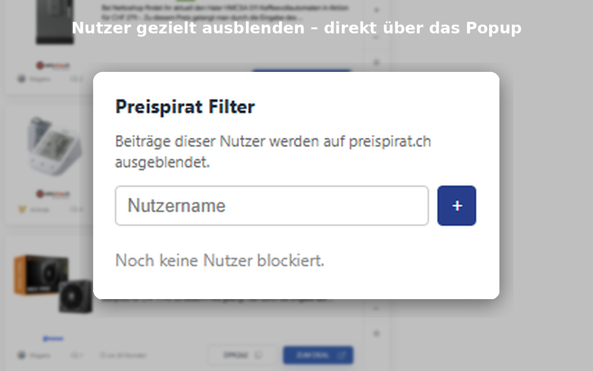

# 🏴‍☠️ Preispirat Filter

**Eine schlanke Chrome-Erweiterung, die Deal-Beiträge bestimmter Nutzer auf [preispirat.ch](https://www.preispirat.ch) ausblendet.**

> Für eine aufgeräumtere, persönlichere Deal-Übersicht – ohne Spam und ohne unerwünschte Beiträge.

---

## ✨ Features

- 🚫 Beliebig viele Nutzernamen blockieren (und wieder entfernen)
- 🔄 Automatische Erkennung neu geladener Deals (Infinite Scroll / MutationObserver)
- 📱 Einstellungen werden über `chrome.storage.sync` geräteübergreifend synchronisiert
- 🔒 100 % lokal – keine Daten werden an Dritte übertragen
- 🎨 Einfaches, übersichtliches Popup

## 📦 Installation (Entwicklermodus)

1. Repository klonen oder als ZIP herunterladen.
2. In Chrome zu `chrome://extensions` gehen.
3. Oben rechts **Entwicklermodus** aktivieren.
4. Auf **Entpackte Erweiterung laden** klicken und den **Root-Ordner** dieses Repositories auswählen (dort liegt die `manifest.json`).
5. Die Erweiterung erscheint in der Symbolleiste (ggf. anpinnen).

> **Tipp:** Die Erweiterung funktioniert nur auf `https://www.preispirat.ch/*`.

## 💻 Benutzung

1. Auf das Erweiterungssymbol klicken.
2. Nutzernamen eintragen (z. B. `Arlinda`) und mit **Hinzufügen** oder Enter bestätigen.
3. Preispirat.ch neu laden oder weiter scrollen – Beiträge dieser Nutzer werden automatisch ausgeblendet.
4. Zum Entfernen auf das **✕** neben dem Namen klicken.

## 🛠️ Funktionsweise

Die Erweiterung sucht nach Textknoten, die exakt einem blockierten Nutzernamen entsprechen, und blendet den umgebenden Deal-Container aus.

Die Erkennung basiert auf einer Heuristik (`looksLikeCard` in `content.js`):
- Container mit Bild + Preisangabe (CHF) oder Zeitangabe
- Begrenzte Größe, damit nicht versehentlich zu viel ausgeblendet wird

Da preispirat.ch seine Struktur ändern kann, ist die Logik bewusst konservativ.

## 🔒 Datenschutz

- Die Blockliste wird ausschliesslich lokal (bzw. via Chrome Sync) gespeichert.
- Es werden keine Nutzerdaten gesammelt, übertragen oder verkauft.
- Die Erweiterung hat nur Zugriff auf `preispirat.ch` und die Storage-API.

## 📸 Screenshots

*Nutzer gezielt ausblenden – direkt über das Popup*

## 🛤️ Chrome Web Store

Texte und Hinweise für einen möglichen Store-Eintrag findest du in [`STORE_LISTING.md`](STORE_LISTING.md).

## 📜 Lizenz

Dieses Projekt steht unter der [MIT-Lizenz](LICENSE).

---

**Inoffizielles Community-Tool** – keine Verbindung zu preispirat.ch oder Preispirat GmbH.
